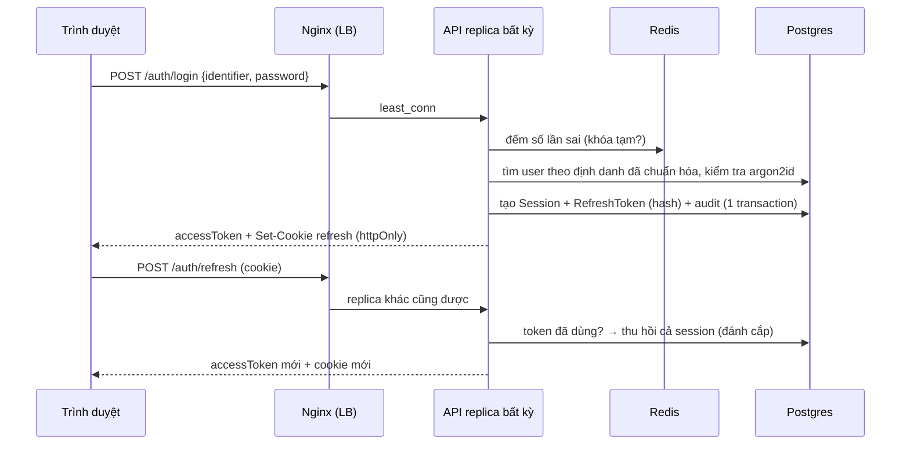

# Spec: Identity — đăng nhập, phiên, phân quyền (spec mẫu)

- Module: identity · Người phụ trách: TV1 · Trạng thái: **Đã xong** (Phase 0, cập nhật 2026-11-15)
- Liên quan: [ADR-0004](../adr/0004-auth-tokens.md), [ADR-0005](../adr/0005-load-balancing-realtime.md), PR #1 (đã merge), PR #2 (chuẩn hóa định danh, thông báo lỗi tiếng Việt)
- Code: `backend/src/modules/identity`, `packages/shared/src/auth.ts`, `backend/prisma/schema/identity.prisma`, `frontend/src/auth`, `frontend/src/lib/api-client.ts`, `frontend/src/pages/LoginPage.jsx`

> Đây là **spec mẫu**: module mới viết spec theo đúng khung này ([_template.md](_template.md)).

## 1. Mục tiêu

Một cơ chế xác thực dùng chung cho web, app di động sau này và mọi replica API:

- Đăng xuất hoặc khóa tài khoản có hiệu lực **ngay lập tức** trên mọi replica.
- Phát hiện refresh token bị đánh cắp (dùng lại token cũ) và cắt phiên.
- Không thể dò mật khẩu: khóa tạm theo tài khoản + rate limit theo IP.
- Trình duyệt không lưu token ở nơi JavaScript đọc được lâu dài (không `localStorage`).

## 2. Phạm vi

|                            |                                                                                                                                                                                                                                      |
| -------------------------- | ------------------------------------------------------------------------------------------------------------------------------------------------------------------------------------------------------------------------------------ |
| **Trong phạm vi (đã làm)** | Đăng ký khách hàng; đăng nhập bằng email hoặc mã KTV; refresh token xoay vòng; đăng xuất 1 thiết bị / tất cả; `GET /auth/me`; RBAC 3 vai trò; admin liệt kê + khóa/mở khóa người dùng; màn hình đăng nhập/đăng ký giống y hệt bản cũ |
| **Chưa làm (MVP, TV1)**    | Quên mật khẩu qua email thật (giao diện vẫn mô phỏng như bản cũ), đổi mật khẩu, admin quản lý KTV, xem audit log                                                                                                                     |
| **Sau MVP**                | Xác minh email/SĐT bằng OTP, đăng nhập Google, xác thực 2 lớp cho admin, trang "thiết bị đang đăng nhập"                                                                                                                             |

## 3. Luồng người dùng

1. Người dùng mở `/login` (giao diện `portal/RootShell.jsx` cũ: tab Đăng nhập / Đăng ký / Quên mật khẩu).
2. Nhập email (khách hàng, admin) hoặc mã KTV (`TECH-088`) + mật khẩu → `POST /auth/login`.
3. Server trả `accessToken` (15 phút) trong body; refresh token nằm trong **cookie httpOnly, SameSite=Strict, path `/api/v1/auth`** (app di động nhận trong body khi gửi header `x-client-type: mobile`).
4. Frontend giữ access token **trong bộ nhớ**, chuyển trang theo vai trò: `CUSTOMER` → `/`, `TECHNICIAN` → `/technician`, `ADMIN` → `/admin/users`.
5. Khi access token hết hạn hoặc tải lại trang: `POST /auth/refresh` (cookie tự gửi kèm) → token mới, refresh token cũ bị đánh dấu đã dùng. Nhiều tab chỉ refresh một lần nhờ Web Locks; đăng xuất ở một tab báo cho các tab khác qua BroadcastChannel.
6. Đăng xuất → session bị thu hồi trong Postgres **và** ghi vào Redis, mọi replica từ chối access token còn hạn của session đó.

## 4. API (hợp đồng)

| Method | Path                           | Vai trò                                    | Request                       | Response              | Lỗi (`code`)                                                      |
| ------ | ------------------------------ | ------------------------------------------ | ----------------------------- | --------------------- | ----------------------------------------------------------------- |
| POST   | /api/v1/auth/register          | public, 5 lần/phút/IP                      | `registerSchema`              | `AuthResponse` 201    | `AUTH_EMAIL_TAKEN`, `VALIDATION_FAILED`                           |
| POST   | /api/v1/auth/login             | public, 10 lần/phút/IP                     | `loginSchema`                 | `AuthResponse`        | `AUTH_INVALID_CREDENTIALS`, `AUTH_ACCOUNT_LOCKED`, `RATE_LIMITED` |
| POST   | /api/v1/auth/refresh           | public (cookie / body mobile), 30 lần/phút | `refreshSchema`               | `AuthResponse`        | `AUTH_REFRESH_INVALID`, `AUTH_REFRESH_REUSED`                     |
| POST   | /api/v1/auth/logout            | mọi vai trò                                | –                             | 204                   | `UNAUTHENTICATED`                                                 |
| POST   | /api/v1/auth/logout-all        | mọi vai trò                                | –                             | 204                   | `UNAUTHENTICATED`                                                 |
| GET    | /api/v1/auth/me                | mọi vai trò                                | –                             | `AuthUser`            | `UNAUTHENTICATED`                                                 |
| GET    | /api/v1/admin/users            | ADMIN                                      | `role,status,q,page,pageSize` | `Page<AdminUserView>` | `FORBIDDEN`                                                       |
| PATCH  | /api/v1/admin/users/:id/status | ADMIN                                      | `{status, reason}`            | `AdminUserView`       | `NOT_FOUND`, `FORBIDDEN` (tự khóa mình)                           |

Mọi lỗi có cùng dạng `{ code, message, requestId }`, `message` là câu tiếng Việt cho người dùng; client rẽ nhánh theo `code`. Lỗi do framework sinh ra (sai đường dẫn, JSON hỏng, sai method…) cũng trả câu tiếng Việt chung, **không lộ đường dẫn hay chi tiết nội bộ**. Xem Swagger: `http://localhost:4000/api/docs`.

## 5. Dữ liệu

`backend/prisma/schema/identity.prisma`:

| Bảng             | Nội dung                                                                                                       |
| ---------------- | -------------------------------------------------------------------------------------------------------------- |
| `users`          | email, phone, `technician_code` (đều unique), `password_hash` (argon2id), `role`, `status` (`ACTIVE`/`LOCKED`) |
| `sessions`       | một dòng cho mỗi thiết bị đăng nhập; `id` = claim `sid` trong access token; `revoked_at`, `revoke_reason`      |
| `refresh_tokens` | chỉ lưu SHA-256 của token; `used_at` đánh dấu đã xoay vòng                                                     |

Redis: `auth:revoked-sid:<sid>` (session đã thu hồi, sống bằng thời hạn access token), bộ đếm đăng nhập sai theo định danh (15 phút), bộ đếm rate limit của Throttler (dùng chung giữa các replica).

Cấu hình: `JWT_ACCESS_TTL_SECONDS` (mặc định 900), `REFRESH_TOKEN_TTL_DAYS` (mặc định 14). Production từ chối khởi động nếu dùng secret mặc định của môi trường dev.

## 6. Quy tắc nghiệp vụ & chống bypass

- **Tự đăng ký luôn là `CUSTOMER`.** Schema `.strict()`: gửi thêm field lạ (ví dụ `role: "ADMIN"`) → 400.
- **Mật khẩu:** tối thiểu 8 ký tự, có chữ cái và chữ số (bản cũ chấp nhận 6 ký tự; giao diện giữ nguyên, server báo lỗi bằng tiếng Việt).
- **Chuẩn hóa định danh:** NFKC + bỏ khoảng trắng; có `@` thì chữ thường (email), không có thì chữ hoa (mã KTV, `tech-088` → `TECH-088`). Cùng một chuỗi đã chuẩn hóa dùng cho **cả** tìm tài khoản **và** bộ đếm khóa tạm, nên không thể né khóa bằng cách đổi hoa/thường hay dùng ký tự Unicode trông giống nhau.
- **Khóa tạm:** sai 5 lần / 15 phút / định danh → `RATE_LIMITED` (429), từ chối kể cả khi nhập đúng mật khẩu. Thêm rate limit theo IP ở Nginx (30 request/giây) và ở từng route API (bảng mục 4).
- **Khóa bởi admin:** tài khoản `LOCKED` đăng nhập → `AUTH_ACCOUNT_LOCKED` (403).
- **Không tiết lộ tài khoản có tồn tại hay không:** sai email và sai mật khẩu trả cùng một lỗi.
- **Refresh token xoay vòng:** mỗi lần dùng cấp token mới; dùng lại token cũ = dấu hiệu bị đánh cắp → thu hồi cả session, cả hai bên phải đăng nhập lại.
- **Khóa tài khoản** (admin) → thu hồi mọi session ngay; admin không tự khóa chính mình.
- **Web:** access token chỉ nằm trong bộ nhớ (`frontend/src/lib/api-client.ts`), không bao giờ ghi `localStorage`; mọi lời gọi qua `apiFetch()`.
- Mọi đăng nhập, đăng xuất, khóa/mở khóa ghi **audit log**.

## 7. Event

- Phát: `identity.user_registered { userId, email, fullName }` qua outbox, **cùng transaction** với việc tạo user (worker gửi đi sau, at-least-once).
- Tiêu thụ: chưa có. Dự kiến notifications (TV4) gửi email chào mừng khi nhận event này.

## 8. Kiểm thử

- **Unit (17):** `auth.service.spec.ts` (chuẩn hóa định danh, khóa tạm dùng chung một key), `password.service.spec.ts`, `token.service.spec.ts`, `roles.guard.spec.ts`, `common/config/env.schema.spec.ts`.
- **E2E (14), `backend/test/auth.e2e-spec.ts`** trên Postgres + Redis thật:
  1. Health `live` / `ready` cho load balancer.
  2. Header bảo mật, có Content-Security-Policy.
  3. Truy cập không token → 401 với dạng lỗi chung.
  4. Không lộ thông báo lỗi của framework (ví dụ đường dẫn được gọi).
  5. Đăng ký khách hàng, token dùng được ngay.
  6. Web chỉ nhận refresh token qua cookie httpOnly SameSite=Strict.
  7. Email trùng bị từ chối.
  8. Field lạ bị từ chối (không tự nâng lên ADMIN).
  9. Khóa tạm sau 5 lần sai, kể cả khi nhập đúng mật khẩu.
  10. Xoay vòng refresh token; dùng lại token cũ → session bị hủy.
  11. Đăng xuất thu hồi access token ngay (qua Redis, mọi replica).
  12. Khách hàng không vào được route admin.
  13. Khóa tài khoản → kết thúc mọi session, chặn đăng nhập mới.
  14. Event `identity.user_registered` nằm trong outbox cùng transaction với đăng ký.
- **Thủ công trên trình duyệt (đã làm):** sai mật khẩu, đăng nhập khách hàng, tải lại trang vẫn giữ phiên, đăng xuất (refresh sau đó trả 401), đăng nhập `TECH-088`, đăng ký với mật khẩu yếu và mạnh; giao diện `/login` trùng HTML với bản cũ.
- **Tải:** `tests/load/auth-smoke.js` (k6) qua Nginx + 3 replica.

## 9. Câu hỏi mở / việc tiếp theo

- [ ] Quên mật khẩu: token một lần qua email (Mailpit ở dev), cần notifications của TV4. Giao diện giữ nguyên bản cũ.
- [ ] Đổi mật khẩu → thu hồi các session khác.
- [ ] Admin quản lý KTV (tạo tài khoản + mã `TECH-xxx`), xem audit log.
- [ ] Ghép người dùng với dữ liệu mẫu đang theo email/mã KTV trong mock; khi có API thật của profile thì bỏ.
- [ ] Sau MVP: OTP, Google, 2FA cho admin (xem [team.md](../team.md) mục 2.3).
