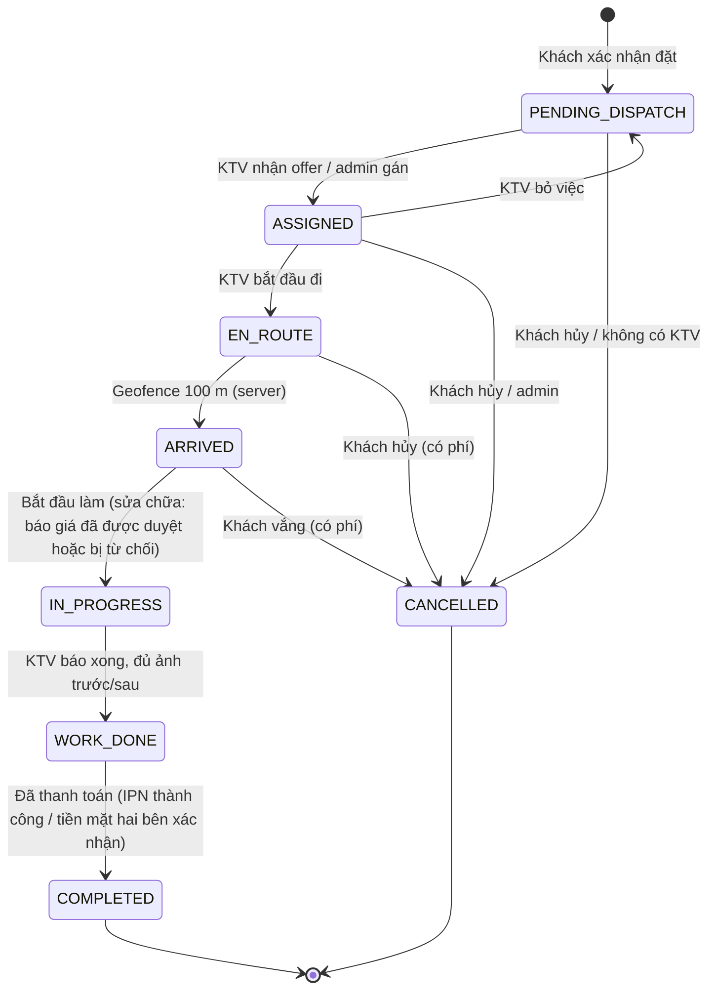

# Spec: Luồng nghiệp vụ HomeCare (khách, kỹ thuật viên, admin)

- Module: booking, dispatch, payments, technician, support, assistant · Người phụ trách: cả nhóm (Lead điều phối) · Trạng thái: **Nháp, chờ duyệt 24/11/2026**
- Liên quan: [Rà soát nghiệp vụ 23/11](../review/2026-11-23-ra-soat-nghiep-vu.md), [ADR-0009](../adr/0009-thanh-toan-khi-hoan-thanh-va-so-cai-ktv.md), [ADR-0010](../adr/0010-tro-ly-ai-mot-agent.md), [phan-cong.md](../phan-cong.md)

> Tài liệu này là **nguồn chuẩn cho quy tắc nghiệp vụ**. Spec của từng module (`docs/specs/<module>.md`) chi tiết hóa API và dữ liệu, nhưng không được mâu thuẫn với các quy tắc ở đây. Mã `PAY-1`, `BKG-1`… trỏ về phát hiện trong tài liệu rà soát.

## 1. Mục tiêu

- Một bức tranh chung về các hành trình của khách, KTV và admin để bốn gói làm song song mà không hiểu lệch nhau.
- Quy trình gần với sàn dịch vụ thật, nhưng chỉ ở mức một đồ án làm được trong 5 tuần.
- Mọi điểm có tiền, dữ liệu cá nhân hoặc trạng thái đều có quy tắc chặn đi vòng (bypass) ở server.

## 2. Phạm vi

- **Trong phạm vi:** đặt lịch (bấm và chat), điều phối, theo dõi, báo giá tại chỗ, thanh toán khi hoàn thành (qua app hoặc tiền mặt), sổ cái KTV, hủy, đổi lịch, khách vắng, khiếu nại, hoàn tiền, đặt lại thợ quen, tem QR, trợ lý AI.
- **Ngoài phạm vi:** tiền thật, hóa đơn VAT, bảo hiểm, xác minh danh tính KTV (eKYC), phân quyền admin nhiều cấp, chi trả tự động qua ngân hàng.

## 3. Giá và các con số

| Ký hiệu | Ý nghĩa                                                                                  | Ai quyết định                          |
| ------- | ---------------------------------------------------------------------------------------- | -------------------------------------- |
| `G`     | Giá dịch vụ: giá gói + add-on (vệ sinh) hoặc phí kiểm tra + hạng mục đã duyệt (sửa chữa) | Server, từ catalog và báo giá đã duyệt |
| `F`     | Phí dịch vụ cố định của sàn, hiện ngay từ lúc báo giá                                    | Cấu hình                               |
| `D`     | Giảm giá từ voucher, **do sàn tài trợ**                                                  | Server                                 |
| `T`     | Khách trả: `T = G + F − D` (không cộng phí cổng, không phụ phí theo phương thức)         | Server                                 |
| `c`     | Tỷ lệ hoa hồng (mặc định 20%)                                                            | Cấu hình                               |
| `E`     | Thu nhập KTV: `E = G × (1 − c)`, **không bị trừ bởi voucher**                            | Server                                 |

Client chỉ gửi id (dịch vụ, add-on, địa chỉ, khung giờ, mã voucher, hạng mục báo giá). Mọi số tiền do server tính lại ở mỗi bước (BKG-3, PAY-7).

## 4. Trạng thái booking

| Từ                 | Đến                | Ai                          | Điều kiện                                                                             |
| ------------------ | ------------------ | --------------------------- | ------------------------------------------------------------------------------------- |
| —                  | `PENDING_DISPATCH` | Khách                       | Khung giờ còn năng lực phục vụ (BKG-4); khách không có khoản nợ quá hạn (PAY-3)       |
| `PENDING_DISPATCH` | `ASSIGNED`         | KTV, admin                  | Offer còn hạn; KTV không trùng giờ (ràng buộc DB); KTV không bị tạm ngưng nhận việc   |
| `ASSIGNED`         | `PENDING_DISPATCH` | KTV                         | Bỏ việc có lý do; bị tính vào tỷ lệ bỏ việc; điều phối lại ưu tiên cao (BKG-8)        |
| `ASSIGNED`         | `EN_ROUTE`         | KTV                         | Trong vòng 3 giờ trước giờ hẹn                                                        |
| `EN_ROUTE`         | `ARRIVED`          | Hệ thống                    | Server thấy vị trí trong bán kính 100 m; báo tay chỉ khi GPS yếu và bị gắn cờ (TEC-2) |
| `ARRIVED`          | `IN_PROGRESS`      | KTV                         | Vệ sinh: ngay. Sửa chữa: báo giá ở trạng thái đã duyệt hoặc đã bị từ chối (BKG-1)     |
| `IN_PROGRESS`      | `WORK_DONE`        | KTV                         | Đủ ảnh trước/sau chụp trong app, tải lên trong khung giờ job (TEC-1)                  |
| `WORK_DONE`        | `COMPLETED`        | Hệ thống                    | Payment `SUCCEEDED` qua IPN, hoặc tiền mặt được **cả hai bên** xác nhận (PAY-6)       |
| nhiều trạng thái   | `CANCELLED`        | Khách, KTV, admin, hệ thống | Theo chính sách hủy ở mục 6.5; lưu mã lý do                                           |

Mọi lần chuyển: cập nhật trạng thái + ghi lịch sử + `AuditService.record` + `OutboxService.enqueue` trong một transaction, khóa lạc quan bằng `version`.

> **Thay đổi so với schema hiện tại** (gói A làm trong HC-18 bằng một migration mới, không sửa migration `init`): bỏ `PENDING_PAYMENT`, `CONFIRMED_CASH`, `PAID`, `EXPIRED`; thêm `PENDING_DISPATCH`, `ARRIVED`, `WORK_DONE`; `paymentMethod` không còn bắt buộc lúc đặt; thêm `paymentStatus` (`UNPAID`, `PAID`), `cancelReasonCode`, `preferredTechnicianId`, `deviceId`.

## 5. Hành trình của khách

### 5.1 Đặt lịch

1. Chọn dịch vụ → (vệ sinh) gói, add-on / (sửa chữa) nhóm sự cố, mức khẩn → ngày giờ → địa chỉ → (tùy chọn) thợ quen → voucher.
2. Server trả báo giá: `G`, `F`, `D`, `T`. Với sửa chữa, `G` lúc này chỉ là **phí kiểm tra**; màn hình ghi rõ "giá cuối do thợ báo tại nhà, bạn duyệt trên app".
3. Khách bấm **Xác nhận** → `POST /bookings` với `Idempotency-Key` → `PENDING_DISPATCH`. Voucher được giữ lượt ngay trong transaction này (BKG-2).
4. Chặn: địa chỉ ngoài khu vực phục vụ; giờ hẹn sớm hơn 2 giờ hoặc xa hơn 30 ngày; khung giờ hết năng lực; khách đang nợ quá hạn.

### 5.2 Đặt lịch qua trợ lý AI

Trợ lý dùng **đúng các service** của luồng 5.1 (xem mục 9). Khác biệt duy nhất: trợ lý tạo một **lịch nháp** có hạn 15 phút và hiện thẻ (dịch vụ, giờ, địa chỉ, giá). Lịch thật chỉ được tạo khi khách bấm nút Xác nhận trên thẻ, đi qua `POST /bookings` như bấm tay (AI-1).

### 5.3 Điều phối

1. Ngay khi có `booking.created`, dispatch xếp hạng KTV: đúng kỹ năng, trong khu vực, không trùng giờ, không bị tạm ngưng, rồi chấm điểm theo khoảng cách, điểm đánh giá, tải việc, tỷ lệ nhận việc (BKG-8, BKG-10).
2. Có thợ quen thì offer cho người đó trước.
3. Offer gửi cho **một KTV mỗi lượt**, hạn 10 phút (lịch hẹn) hoặc 90 giây (sửa chữa khẩn) (BKG-9). Hết hạn hoặc từ chối thì chuyển người kế tiếp.
4. Hết danh sách → booking vào hàng đợi **điều phối tay** của admin; trước giờ hẹn 1 giờ vẫn chưa có người → hệ thống hủy miễn phí, báo khách, trả lượt voucher (BKG-5).

### 5.4 Theo dõi

- Từ `EN_ROUTE`: bản đồ vị trí KTV và ETA, timeline lấy từ lịch sử trạng thái.
- `ARRIVED` do server quyết định từ vị trí; khách nhận thông báo "Thợ đã đến".
- Chat khách–KTV mở từ `ASSIGNED`; số điện thoại hai bên không bao giờ hiện; tin nhắn có chuỗi giống số điện thoại hoặc link mạng xã hội bị che (TEC-3).

### 5.5 Tại nhà: báo giá (chỉ sửa chữa)

1. KTV kiểm tra, chọn **hạng mục** từ danh mục sửa chữa (mỗi hạng mục có khung giá tối thiểu–tối đa), nhập giá trong khung, kèm ghi chú và ảnh tình trạng.
2. Khách nhận thông báo, xem từng dòng và tổng mới, bấm **Duyệt** hoặc **Từ chối** trên app.
3. Duyệt: `G` = phí kiểm tra + các hạng mục (phí kiểm tra được trừ vào tổng nếu cấu hình như vậy). Từ chối: chỉ tính phí kiểm tra, KTV báo xong luôn.
4. Phát sinh thêm trong lúc làm thì lặp lại bước 1–2; không có cách nào tăng giá mà khách không bấm duyệt (BKG-1).

### 5.6 Thanh toán và hoàn tất

1. KTV báo xong (`WORK_DONE`) → khách thấy tổng `T` cuối cùng.
2. Khách chọn:
   - **Trả qua app:** server tạo payment từ `T` (khách không gửi số tiền), mở cổng giả lập; chỉ IPN hợp lệ mới chuyển payment sang `SUCCEEDED` → booking `COMPLETED`.
   - **Tiền mặt cho KTV:** KTV ghi "đã thu `T`" → khách bấm xác nhận "đã trả" → `COMPLETED`. Hai bên khai lệch thì tự mở khiếu nại (PAY-6).
3. Sau `COMPLETED`: khách đánh giá (một lần, chỉ booking đã thanh toán), có thể bấm **Xác nhận hài lòng** để giải ngân sớm.
4. 24 giờ sau `WORK_DONE` mà chưa thanh toán: KTV được bấm "chưa thu được"; khoản `T` thành **nợ của khách**, khách không đặt được lịch mới cho đến khi trả (PAY-3).

### 5.7 Hủy, đổi lịch, khách vắng

| Tình huống                                                | Phí                                                        | Tiền phí đi đâu          |
| --------------------------------------------------------- | ---------------------------------------------------------- | ------------------------ |
| Khách hủy khi còn ≥ 2 giờ và KTV chưa xuất phát           | Miễn phí                                                   | —                        |
| Khách hủy khi < 2 giờ hoặc KTV đã `EN_ROUTE`              | Phí hủy muộn (cấu hình)                                    | 80% cho KTV, 20% cho sàn |
| Khách vắng: đã `ARRIVED`, chờ 15 phút, đã liên hệ qua app | Phí hủy muộn                                               | Như trên                 |
| Không có KTV nhận, hoặc KTV bỏ việc mà không thay được    | Miễn phí, trả lượt voucher                                 | —                        |
| Đổi lịch khi còn ≥ 2 giờ                                  | Miễn phí; giữ nguyên booking, điều phối lại nếu KTV cũ bận | —                        |

Phí hủy muộn được thu ở lần thanh toán kế tiếp (ghi thành nợ của khách) vì lúc đặt khách chưa trả gì.

### 5.8 Khiếu nại và bảo hành

- **Trong 24 giờ** sau `COMPLETED`: khiếu nại có thể dẫn đến hoàn tiền; thu nhập của KTV cho job đó đứng ở trạng thái chờ đến khi xử lý xong.
- **Bảo hành sửa chữa 7 ngày:** chỉ "làm lại" miễn phí, không hoàn tiền (trừ khi admin quyết định khác).
- Bắt buộc mô tả và ít nhất một ảnh. Tổng tiền hoàn ≤ số đã trả (ACC-2, ACC-3).
- Cách xử lý: hoàn tiền (một phần hoặc toàn bộ), làm lại, voucher, trừ điểm KTV. Nếu KTV đã được chi trả thì thu hồi qua sổ cái (PAY-5).
- Chỉ job hoàn thành **trong app** mới được bảo hành và khiếu nại. Đây là lý do chính để khách không giao dịch riêng.

### 5.9 Sau dịch vụ

- **Đặt lại thợ quen:** từ chi tiết lịch cũ, khách chọn đặt lại cùng KTV; offer đi đến KTV đó trước (BKG-11).
- **Tem QR:** KTV dán tem và nhập model/serial ở lần đến đầu, chỉ khi đang có job với khách đó; khách thấy và sửa được (ACC-4). Quét tem: chủ nhà xem lịch sử và đặt lại; người khác quét không thấy gì.
- **Nhắc bảo trì:** job định kỳ tạo nhắc theo chu kỳ từng loại thiết bị; "sức khỏe" thiết bị do server tính (ACC-5).

## 6. Hành trình của KTV

1. **Tài khoản:** admin tạo (mã `TECH-xxx`, kỹ năng, khu vực). Email, SĐT không được trùng với một tài khoản khách (ACC-6).
2. **Ca làm:** bật "nhận việc". Không nhận được offer khi: tắt nhận việc, **tạm ngưng nhận việc** do nợ vượt hạn mức, hoặc bị admin khóa đăng nhập. Tạm ngưng nhận việc **không** chặn đăng nhập, để KTV vẫn nạp tiền trả nợ được (TEC-5).
3. **Nhận việc:** offer hiện khu vực (quận/phường), khoảng cách, giờ, dịch vụ, thu nhập dự kiến; **không** hiện tên, số nhà khách. Nhận từ push hoặc trong app.
4. **Đi và đến:** bấm bắt đầu đi; app gửi vị trí chạy nền; server tính ETA và geofence.
5. **Làm việc:** (sửa chữa) báo giá tại chỗ → chờ khách duyệt; chụp ảnh trước/sau bằng camera trong app; báo xong.
6. **Thu tiền:** nếu khách trả tiền mặt, ghi "đã thu".
7. **Thu nhập:** xem từng job (`G`, hoa hồng, `E`), số dư chờ / khả dụng / nợ; nạp tiền trả nợ qua cổng giả lập.

**Dữ liệu khách KTV được xem (TEC-4):**

| Giai đoạn                           | Được xem                                    |
| ----------------------------------- | ------------------------------------------- |
| Offer                               | Quận/phường, khoảng cách, dịch vụ, giờ      |
| `ASSIGNED` → 24 giờ sau `COMPLETED` | Tên, địa chỉ đầy đủ, ghi chú, chat          |
| Sau đó                              | Quận/phường; chat chỉ đọc đến 7 ngày rồi ẩn |
| Bất kỳ lúc nào                      | **Không bao giờ** thấy SĐT, email khách     |

## 7. Admin

- **Điều phối tay:** gán = gửi offer ưu tiên cho KTV được chọn; ép gán (không cần KTV đồng ý) phải ghi lý do.
- **Đối soát:** xem payment, IPN (kể cả IPN sai chữ ký), hoàn tiền, sổ cái KTV; đánh dấu đợt chi trả hằng tuần đã chuyển (PAY-8).
- **Hỗ trợ và khiếu nại:** hàng đợi ticket, chat, ghi chú nội bộ, quyết định xử lý khiếu nại.
- **Không có** thao tác sửa giá hay số tiền trực tiếp. Mọi điều chỉnh đi qua bản ghi hoàn tiền, voucher hoặc bút toán sổ cái, đều có lý do và audit.

## 8. Sổ cái KTV

Mỗi KTV có một sổ cái chỉ ghi thêm (append-only). Số dư = tổng các bút toán; dương là sàn nợ KTV, âm là KTV nợ sàn.

| Sự kiện                                | Bút toán                           | Trạng thái ban đầu                                        |
| -------------------------------------- | ---------------------------------- | --------------------------------------------------------- |
| Job trả qua app hoàn tất               | `+E`                               | Chờ; khả dụng sau 24 giờ hoặc khi khách xác nhận hài lòng |
| Job tiền mặt hoàn tất                  | `+E − T` (thường âm = nợ hoa hồng) | Khả dụng ngay                                             |
| Phí hủy muộn khách đã trả              | `+80% phí`                         | Khả dụng                                                  |
| Khiếu nại được hoàn sau khi đã chi trả | `−phần thu hồi`                    | Khả dụng                                                  |
| KTV nạp tiền trả nợ                    | `+số nạp`                          | Khả dụng (sau IPN)                                        |
| Đợt chi trả                            | `−số chi`                          | Khả dụng                                                  |

- Số dư khả dụng < −300.000đ (cấu hình) → phát `technician.dispatch_suspended`; về lại ≥ 0 → `technician.dispatch_resumed` (PAY-1).
- Chỉ chi trả phần khả dụng dương; job đang có khiếu nại không chuyển sang khả dụng.

## 9. Trợ lý AI

Một agent, hai điểm vào: màn **Đặt lịch bằng chat** và màn **Hỗ trợ**. Chạy bằng quyền của chính người dùng (ADR-0010).

| Công cụ                | Dữ liệu                           | Ghi chú                                                  |
| ---------------------- | --------------------------------- | -------------------------------------------------------- |
| `search_services`      | Catalog (gói A)                   | Không dùng RAG cho dữ liệu có cấu trúc; không bịa giá    |
| `get_quote`            | Hàm báo giá (gói A)               | Trả `G`, `F`, `D`, `T`                                   |
| `get_availability`     | Lịch trống (gói A)                |                                                          |
| `create_booking_draft` | Lịch nháp, hạn 15 phút            | Chỉ tạo nháp; khách bấm Xác nhận mới thành lịch thật     |
| `get_my_bookings`      | Booking của chính người hỏi       | Lọc theo chủ sở hữu ở server                             |
| `search_policies`      | RAG trên tài liệu chính sách, FAQ | Trả lời kèm nguồn; không có nguồn thì nói không biết     |
| `handoff_to_staff`     | Tạo ticket hỗ trợ (gói C)         | Bắt buộc khi liên quan tiền, an toàn, hoặc khách yêu cầu |

- Bot **không** thực hiện thanh toán, hủy, hoàn tiền; chỉ dẫn khách tới màn tương ứng.
- Nội dung khách gõ và kết quả công cụ là dữ liệu, không phải lệnh; mỗi lần gọi công cụ được audit; giới hạn số tin mỗi người mỗi ngày.
- MCP server (HC-75) mở **đúng bộ công cụ này**, xác thực bằng token của người dùng.

## 10. Tham số cấu hình (giá trị mặc định đề xuất)

| Tham số                                | Mặc định          |
| -------------------------------------- | ----------------- |
| Tỷ lệ hoa hồng `c`                     | 20%               |
| Phí dịch vụ `F`                        | 15.000đ           |
| Hạn mức nợ KTV                         | 300.000đ          |
| Giữ thu nhập trước khi khả dụng        | 24 giờ            |
| Thời hạn hoàn tiền / bảo hành sửa chữa | 24 giờ / 7 ngày   |
| Hạn offer lịch hẹn / sửa chữa khẩn     | 10 phút / 90 giây |
| Hủy miễn phí trước giờ hẹn             | 2 giờ             |
| Phí hủy muộn, phần cho KTV             | 30.000đ, 80%      |
| Chờ khách vắng                         | 15 phút           |
| Đặt trước tối thiểu / tối đa           | 2 giờ / 30 ngày   |
| Geofence "đã đến"                      | 100 m             |
| Hạn giao dịch trên cổng                | 15 phút           |
| Hạn lịch nháp của trợ lý               | 15 phút           |

## 11. Sự kiện (outbox)

| Sự kiện                                      | Phát bởi | Ai nghe                                    |
| -------------------------------------------- | -------- | ------------------------------------------ |
| `booking.created`                            | booking  | dispatch, notifications                    |
| `booking.status_changed`                     | booking  | realtime, notifications, payments, support |
| `dispatch.offer_created` / `_expired`        | dispatch | notifications (push có nút), realtime      |
| `booking.quote_proposed` / `_decided`        | booking  | notifications, realtime                    |
| `payment.succeeded` / `payment.failed`       | payments | booking (→ `COMPLETED`), notifications     |
| `payment.cash_confirmed`                     | payments | booking (→ `COMPLETED`)                    |
| `ledger.earning_released`                    | payments | notifications                              |
| `technician.dispatch_suspended` / `_resumed` | payments | technician, dispatch, notifications        |
| `dispute.opened` / `dispute.resolved`        | support  | payments (giữ / thả thu nhập, hoàn tiền)   |
| `refund.succeeded`                           | payments | support, notifications                     |
| `support.message_created`                    | support  | assistant (bot trả lời trước)              |

Mọi handler idempotent (giao ít nhất một lần).

## 12. Ảnh hưởng tới các ticket

| Gói  | Ticket hiện có cần sửa mô tả                                                                                                                                                                                                                                | Việc mới cần tạo                                       |
| ---- | ----------------------------------------------------------------------------------------------------------------------------------------------------------------------------------------------------------------------------------------------------------- | ------------------------------------------------------ |
| A    | HC-18 (trạng thái mới), HC-29 (phí kiểm tra, voucher do sàn chịu, bỏ phụ phí), HC-31 (năng lực theo khung giờ), HC-33 (không chọn phương thức trả lúc đặt), HC-51 (điều phối ngay khi tạo, bộ lọc), HC-56 (hạn offer, không có KTV), HC-71 (chính sách hủy) | Báo giá tại chỗ (backend); Đặt lại thợ quen            |
| B    | HC-30 (dữ liệu khách theo giai đoạn, tạm ngưng nhận việc), HC-35, HC-45 (lọc SĐT), HC-52 (geofence ở server), HC-54/HC-72 (ảnh trong khung giờ job)                                                                                                         | App thợ: báo giá tại chỗ, ghi tiền mặt, báo khách vắng |
| C    | HC-62, HC-63 (thời hạn, giới hạn hoàn), HC-50 (KTV đăng ký thiết bị khi có job), HC-23 (sức khỏe thiết bị do server tính), HC-42 (không trùng email/SĐT với khách)                                                                                          | —                                                      |
| Lead | HC-36 (tạo payment khi `WORK_DONE`), HC-38, HC-57 (thu nhập chờ → khả dụng), HC-77 (sổ cái đầy đủ), HC-74 (hạ xuống nếu kịp), HC-53 + HC-95 (một agent)                                                                                                     | Nợ của khách và chặn đặt mới; KTV nạp tiền trả nợ      |

## 13. Câu hỏi mở (chốt trong buổi họp 24/11)

1. Phí kiểm tra sửa chữa có được trừ vào tổng khi khách duyệt báo giá không? (đề xuất: có)
2. Có cho khách **trả trước** với dịch vụ vệ sinh giá cố định không? (đề xuất: không, để chỉ có một luồng thanh toán)
3. Danh mục hạng mục sửa chữa và khung giá: gói A soạn trong seed của HC-17.
4. Tài liệu chính sách cho RAG (hủy, hoàn tiền, bảo hành, FAQ): Lead soạn trong `docs/policies/`, gói C duyệt câu chữ.
